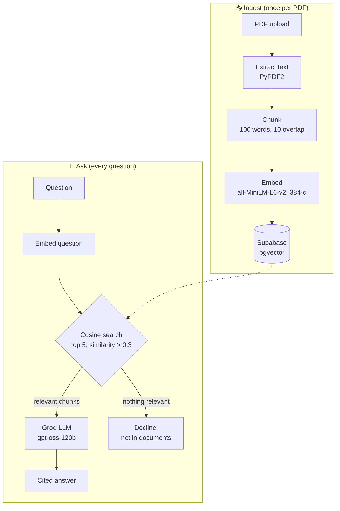
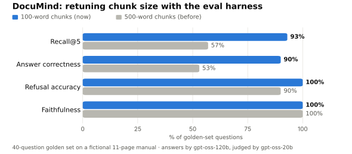
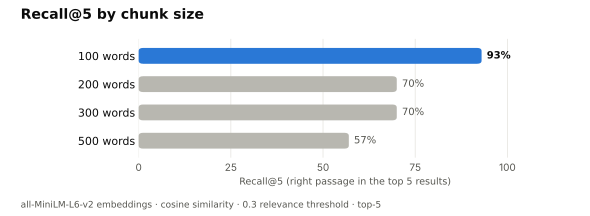

<div align="center">

# 📄 DocuMind

### Ask questions about your PDFs and get cited answers, grounded only in your documents.

<p>
  
  
  
  
</p>
<p>
  
  
  
  
</p>

<a href="https://documind-anikate.streamlit.app"></a>

**[▶ Live demo](https://documind-anikate.streamlit.app)** · [How it works](#-how-it-works) · [Results](#-results) · [Quick start](#-quick-start) · [Evaluation harness](eval/README.md)

</div>

---

## ✨ Highlights

- **Grounded answers with citations.** Every answer cites the chunks it came from as `[1]`, `[2]`, and DocuMind says so when the documents don't contain the answer.
- **Measured, not guessed.** A built-in evaluation harness scores retrieval and answers against a 40-question golden set. It found that the original 500-word chunks were dropping relevant passages, and retuning to 100-word chunks raised answer correctness from **53% to 90%**.
- **Live.** Try it at [documind-anikate.streamlit.app](https://documind-anikate.streamlit.app): upload a PDF and ask away. The app sleeps when idle and wakes in about 30 seconds.
- **Free to run.** Local embeddings, Supabase's free Postgres + pgvector, and Groq's free inference tier.

## 🧭 How it works



| Component | Choice | Why |
|---|---|---|
| Text extraction | PyPDF2 | No external API needed |
| Chunking | Sliding window, 100 words with 10-word overlap | Chosen with the eval harness (see Results) |
| Embeddings | `all-MiniLM-L6-v2` | Free, local, 384-dim, runs on CPU |
| Vector store | Supabase pgvector, `match_chunks` SQL function | Similarity search inside Postgres |
| LLM | Groq `openai/gpt-oss-120b` (set via `GROQ_MODEL`) | Fast free tier; replaced Llama 3.3 after Groq retired it in Aug 2026 |
| Prompting | Citation rules, temperature 0.1 | Cites sources and refuses to invent facts |
| UI | Streamlit with custom CSS | Dark theme, live ingestion progress, typing animation |

## 📊 Results

The [evaluation harness](eval/README.md) runs the app's real chunking, embeddings, threshold and prompt against a
**purpose-built fictional 11-page product manual**, so a correct answer can only come from retrieval, never from the
model's memory. The golden set has 30 answerable questions and 10 the manual cannot answer.

<picture>
  <source media="(prefers-color-scheme: dark)" srcset="docs/documind_results_dark.svg">
  
</picture>

<picture>
  <source media="(prefers-color-scheme: dark)" srcset="docs/documind_chunks_dark.svg">
  
</picture>

| Chunk size | Recall@1 | Recall@3 | Recall@5 | MRR | Correctness | Faithfulness | Refusal accuracy |
|---|---|---|---|---|---|---|---|
| **100 words** | **67%** | **87%** | **93%** | **0.77** | **90%** | **100%** | **100%** |
| 200 words | 57% | 70% | 70% | 0.62 | - | - | - |
| 300 words | 53% | 60% | 70% | 0.58 | - | - | - |
| 500 words (before) | 47% | 57% | 57% | 0.51 | 53% | 100% | 90% |

> **Why 500-word chunks failed:** long chunks dilute the cosine similarity below the 0.3 relevance threshold, so
> relevant passages were filtered out before the top 5. Recall@5 equalled Recall@3, a sign that fewer than five
> chunks were passing the threshold at all.

## 🚀 Quick start

**Prerequisites:** Python 3.11+, a free [Supabase](https://supabase.com) project, and a free [Groq](https://console.groq.com) API key.

```bash
git clone https://github.com/Anikate001/DocuMind-rag-chatbot.git
cd DocuMind-rag-chatbot
pip install -r requirements.txt
cp .env.example .env        # add SUPABASE_URL, SUPABASE_KEY, GROQ_API_KEY
streamlit run app.py        # http://localhost:8501
```

Then upload a PDF in the sidebar, wait for the ingestion steps to finish, and ask a question.

<details>
<summary><b>🗄️ Supabase setup (tables and search function)</b></summary>

1. Create a project at [supabase.com](https://supabase.com).
2. In the SQL editor, enable pgvector and create the tables and search function:

```sql
CREATE EXTENSION IF NOT EXISTS vector;

CREATE TABLE documents (
    id          BIGSERIAL PRIMARY KEY,
    filename    TEXT NOT NULL,
    file_url    TEXT,
    uploaded_at TIMESTAMP DEFAULT NOW()
);

CREATE TABLE chunks (
    id          BIGSERIAL PRIMARY KEY,
    document_id BIGINT REFERENCES documents(id) ON DELETE CASCADE,
    filename    TEXT,
    content     TEXT NOT NULL,
    chunk_index INT,
    embedding   VECTOR(384),
    created_at  TIMESTAMP DEFAULT NOW()
);

CREATE OR REPLACE FUNCTION match_chunks(
    query_embedding VECTOR(384),
    match_count INT DEFAULT 5,
    match_threshold FLOAT DEFAULT 0.3
)
RETURNS TABLE (id BIGINT, content TEXT, filename TEXT, chunk_index INT, similarity FLOAT)
LANGUAGE plpgsql AS $$
BEGIN
    RETURN QUERY
    SELECT chunks.id, chunks.content, chunks.filename, chunks.chunk_index,
           1 - (chunks.embedding <=> query_embedding) AS similarity
    FROM chunks
    WHERE 1 - (chunks.embedding <=> query_embedding) > match_threshold
    ORDER BY chunks.embedding <=> query_embedding
    LIMIT match_count;
END;
$$;
```

3. Copy the **Project URL** and **service_role key** from *Settings → API* into `.env`. Keep the service-role key
   out of version control: it bypasses Row Level Security.

Raw PDFs are also uploaded to a public Storage bucket named `documents`, created automatically on first upload.

</details>

<details>
<summary><b>☁️ Deploy on Streamlit Community Cloud</b></summary>

1. Push the repo to GitHub and open [share.streamlit.io](https://share.streamlit.io) → **Create app**.
2. Pick this repo, branch `main` and main file `app.py`.
3. Under **Advanced settings → Secrets**, paste the keys using the format in
   [`.streamlit/secrets.toml.example`](.streamlit/secrets.toml.example). Root-level secrets become environment
   variables, so no code changes are needed.
4. `requirements.txt` installs CPU-only PyTorch to keep the build small.

</details>

<details>
<summary><b>🔧 Configuration</b></summary>

| Variable | Required | Default |
|---|---|---|
| `SUPABASE_URL` | ✅ | |
| `SUPABASE_KEY` | ✅ | |
| `GROQ_API_KEY` | ✅ | |
| `GROQ_MODEL` | | `openai/gpt-oss-120b` |
| `CHUNK_SIZE` / `CHUNK_OVERLAP` | | `100` / `10` words |
| `SIMILARITY_THRESHOLD` | | `0.3` |
| `MAX_RESPONSE_TOKENS` | | `1024` |

</details>

## 🧪 Run the evaluation

```bash
python eval/run_eval.py --retrieval-only   # free: recall@k and MRR for 4 chunk sizes
python eval/run_eval.py                    # adds LLM-judged correctness, faithfulness, refusals (needs GROQ_API_KEY)
```

Or open [`eval/DocuMind_eval_colab.ipynb`](eval/DocuMind_eval_colab.ipynb) in Google Colab. Details in [`eval/README.md`](eval/README.md).

## 📁 Project structure

```
DocuMind-rag-chatbot/
├── app.py            # Streamlit UI
├── ingest.py         # PDF → chunks → embeddings → pgvector
├── retriever.py      # Question embedding + match_chunks search
├── llm.py            # Groq answer generation with citations
├── text_utils.py     # Credential-free extraction, chunking, context formatting
├── config.py         # Settings from environment variables
├── database.py       # Shared Supabase client
├── eval/             # Golden set, test manual, harness, Colab notebook
└── docs/             # Result charts used in this README
```

<details>
<summary><b>⚡ Engineering notes</b></summary>

- **Row Level Security:** the anon key was blocked by RLS on inserts and Storage, so the app uses the service-role
  key; production use should add RLS policies instead.
- **Storage bucket:** the SDK's `create_bucket()` failed with signature mismatches, so the bucket is created through
  the REST API.
- **Model retirement:** Groq retired `llama3-70b-8192`, then `llama-3.3-70b-versatile` (16 Aug 2026). The model is
  now a single setting, defaulting to Groq's recommended `openai/gpt-oss-120b`.
- **Cold start:** the 90 MB embedding model loads once at import and is cached after the first download.
- **Chunk size:** chosen by measurement rather than intuition; see Results.

</details>

## 📜 License

[MIT](LICENSE)
